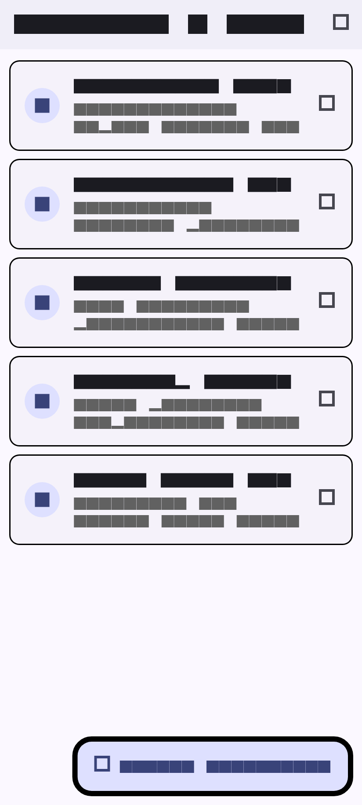
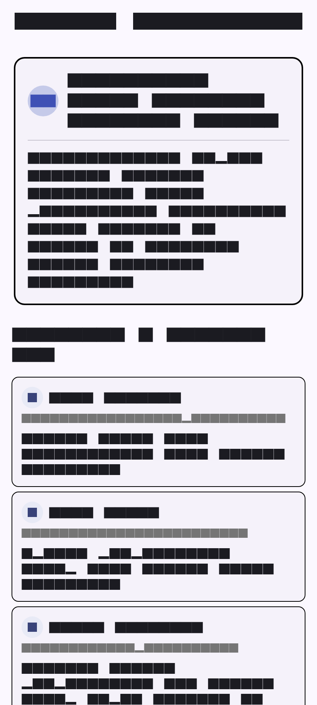
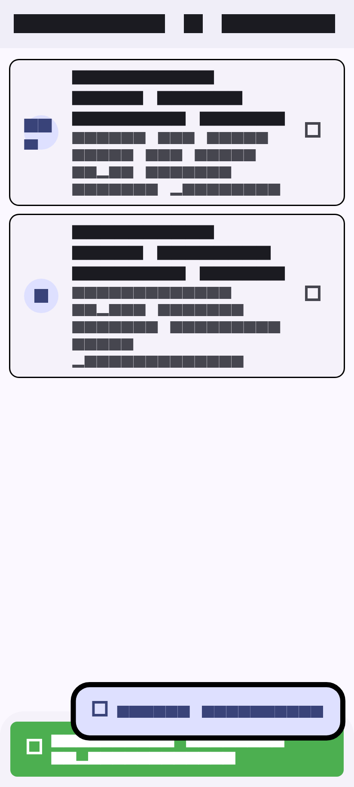
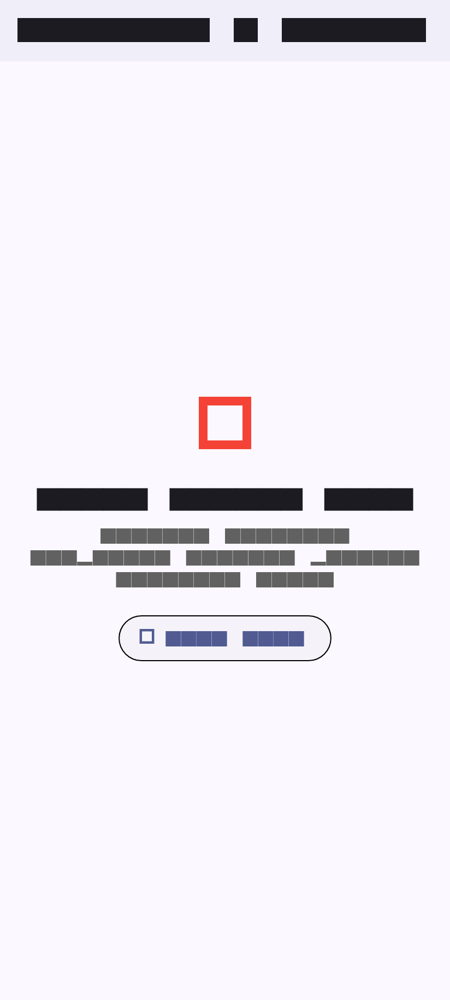

# NusaInfo - Aplikasi Pengumuman Kampus (Flutter HTTP API)

NusaInfo adalah aplikasi mobile berbasis Flutter yang dirancang sebagai portal informasi dan pengumuman interaktif kampus. Aplikasi ini mengimplementasikan integrasi RESTful API menggunakan package http dengan menerapkan pemisahan layer arsitektur (service layer), error handling yang komprehensif, serta validasi formulir.

---

## Informasi Pengembang

- Nama: Amal Hidayah
- Email: amal.hidayah_ti24@nusaputra.ac.id
- Program Studi: Teknik Informatika
- Institusi: Universitas Nusa Putra
- Topik / Tugas: Pemrograman Mobile - HTTP Networking & REST API Integration

---

## Tangkapan Layar Aplikasi (Screenshots)

Berikut adalah dokumentasi visual antarmuka aplikasi NusaInfo pada berbagai kondisi dan alur penggunaan:

| 1. Home Screen (Daftar Pengumuman) | 2. Detail Screen & Komentar |
| :---: | :---: |
|  |  |

| 3. Add Post Screen (Form Input) | 4. Feedback Publikasi (SnackBar) | 5. Penanganan Error (Offline) |
| :---: | :---: | :---: |
|  |  |  |

---

## Fitur dan Kemampuan Aplikasi

1. Daftar Pengumuman (Home Screen)
   - Mengambil data daftar pengumuman secara asinkron dari REST API (GET /posts).
   - Menampilkan nomor ID pengumuman, judul, dan ringkasan isi dalam bentuk kartu (Card).
   - Dilengkapi fitur Pull-to-Refresh (RefreshIndicator) serta tombol muat ulang pada AppBar.
   - Penanganan 3 state utama antarmuka:
     - Loading State: Menampilkan indikator loading CircularProgressIndicator saat data sedang diambil.
     - Error State: Menampilkan pesan kesalahan dan tombol Coba Lagi (Retry) ketika koneksi terputus atau server bermasalah.
     - Data State: Merender daftar pengumuman secara dinamis menggunakan ListView.builder.

2. Detail Pengumuman dan Komentar (Detail Screen)
   - Menampilkan isi lengkap pengumuman yang dipilih.
   - Mengambil dan merender daftar komentar yang terhubung ke pengumuman tersebut (GET /posts/{id}/comments).
   - Dilengkapi identitas komentator (avatar inisial, nama, email, dan isi komentar).

3. Publikasi Pengumuman Baru (Add Post Screen)
   - Formulir input pengumuman dengan kolom Judul dan Isi Pengumuman.
   - Validasi data input menggunakan GlobalKey<FormState> dan validator TextFormField (mencegah pengiriman data kosong).
   - Pengiriman data ke server menggunakan metode POST /posts dengan serialisasi JSON (jsonEncode).
   - Efek pemuatan interaktif pada tombol simpan saat proses request berlangsung.

4. Notifikasi dan Umpan Balik Pengguna
   - Menampilkan Floating SnackBar berwarna hijau dengan ikon centang ketika pengumuman berhasil dibuat.
   - Otomatis memperbarui daftar pengumuman di layar utama setelah pengumuman baru berhasil diterbitkan.

5. Ketahanan Jaringan dan Error Handling
   - Menangkap SocketException untuk mendeteksi kondisi perangkat saat offline atau koneksi internet terputus.
   - Menangkap http.ClientException dan memeriksa HTTP status code (200 OK, 201 Created).
   - Antarmuka menyediakan tombol Coba Lagi untuk melakukan inisiasi ulang pemanggilan data.

---

## Dokumentasi REST API

Aplikasi ini menggunakan public REST API dari JSONPlaceholder:
- Base URL: https://jsonplaceholder.typicode.com

| No | Endpoint | HTTP Method | Header | Deskripsi & Kegunaan | Kode Respons Sukses |
|---|---|:---:|---|---|:---:|
| 1 | /posts | GET | - | Mengambil daftar seluruh pengumuman (posts) | 200 OK |
| 2 | /posts/{id}/comments | GET | - | Mengambil daftar komentar untuk pengumuman spesifik | 200 OK |
| 3 | /posts | POST | Content-Type: application/json; charset=UTF-8 | Menerbitkan data pengumuman baru | 201 Created |

---

## Struktur Direktori Proyek

Proyek ini menerapkan pemisahan tanggung jawab (separation of concerns) yang terstruktur:

```text
nusa_info/
|-- lib/
|   |-- main.dart                  # Entry point aplikasi & konfigurasi tema Material 3
|   |-- models/                    # Data Model dengan serialisasi JSON
|   |   |-- post.dart              # Model Post (id, userId, title, body)
|   |   `-- comment.dart           # Model Comment (id, postId, name, email, body)
|   |-- services/                  # Business logic & layer komunikasi HTTP API
|   |   `-- post_service.dart      # Service HTTP (GET posts, GET comments, POST post)
|   `-- screens/                   # Antarmuka pengguna (UI/Screens)
|       |-- home_screen.dart       # Layar utama: daftar pengumuman, refresh, & state handler
|       |-- detail_screen.dart     # Layar detail pengumuman & daftar komentar
|       `-- add_post_screen.dart   # Layar form penambahan pengumuman & validasi
|-- screenshots/                   # Berkas tangkapan layar antarmuka aplikasi
|   |-- 01_home_screen.png
|   |-- 02_detail_screen.png
|   |-- 03_add_post_screen.png
|   |-- 04_snackbar_success.png
|   `-- 05_error_offline.png
|-- test/                          # Unit testing & widget testing
|   |-- widget_test.dart
|   `-- generate_screenshots_test.dart
|-- pubspec.yaml                   # Konfigurasi dependensi proyek
`-- README.md                      # Dokumentasi komprehensif proyek
```

---

## Implementasi Kunci

### 1. Data Modeling dan Serialisasi JSON
Model Post dan Comment mengimplementasikan factory constructor fromJson untuk konversi dari format JSON ke objek Dart, serta method toJson untuk konversi objek Dart ke format JSON:

```dart
class Post {
  final int? id;
  final int userId;
  final String title;
  final String body;

  Post({this.id, required this.userId, required this.title, required this.body});

  factory Post.fromJson(Map<String, dynamic> json) {
    return Post(
      id: json['id'] as int?,
      userId: json['userId'] as int? ?? 1,
      title: json['title'] as String? ?? '',
      body: json['body'] as String? ?? '',
    );
  }

  Map<String, dynamic> toJson() {
    return {
      if (id != null) 'id': id,
      'userId': userId,
      'title': title,
      'body': body,
    };
  }
}
```

### 2. Service Layer HTTP (PostService)
Seluruh komunikasi jaringan diisolasi ke dalam PostService sehingga komponen antarmuka pengguna tetap bersih dan modular:

```dart
Future<Post> createPost(Post post) async {
  final url = Uri.parse('$_baseUrl/posts');
  final response = await _client.post(
    url,
    headers: {'Content-Type': 'application/json; charset=UTF-8'},
    body: jsonEncode(post.toJson()),
  );

  if (response.statusCode == 201 || response.statusCode == 200) {
    return Post.fromJson(jsonDecode(response.body));
  } else {
    throw Exception('Gagal membuat pengumuman baru: ${response.statusCode}');
  }
}
```

### 3. Asynchronous Execution dan Future Caching
Untuk menghindari pemanggilan API berulang kali pada setiap siklus build widget, inisialisasi Future ditempatkan pada initState():

```dart
@override
void initState() {
  super.initState();
  _loadPosts();
}

void _loadPosts() {
  _postsFuture = _postService.getPosts();
}
```

### 4. Validasi Form dan Notifikasi SnackBar
Formulir input menggunakan Form dan GlobalKey<FormState>. Ketika data berhasil disimpan, pengguna kembali ke layar utama disertai notifikasi berhasil:

```dart
if (_formKey.currentState!.validate()) {
  final newPost = Post(userId: 1, title: _titleController.text, body: _bodyController.text);
  final result = await _postService.createPost(newPost);
  Navigator.pop(context, result);
}
```

---

## Panduan Menjalankan Aplikasi

### Prasyarat
- Flutter SDK (versi 3.13 atau lebih baru)
- Dart SDK
- Web Browser (Google Chrome / Microsoft Edge) atau Android Device / Emulator

### Langkah Instalasi
1. Clone repository ini:
   ```bash
   git clone https://github.com/amal-hidayah/nusa_info.git
   cd nusa_info
   ```

2. Unduh dependensi proyek:
   ```bash
   flutter pub get
   ```

3. Jalankan aplikasi:
   - Menjalankan di Browser (Chrome):
     ```bash
     flutter run -d chrome
     ```
   - Menjalankan di Port Tertentu (misal: 8080):
     ```bash
     flutter run -d chrome --web-port=8080
     ```
   - Menjalankan di Android:
     ```bash
     flutter run -d android
     ```
   - Menjalankan di Windows Desktop:
     ```bash
     flutter run -d windows
     ```

---

## Dependensi Utama

| Package | Versi | Fungsi |
|---|---|---|
| flutter | SDK | Framework UI multi-platform |
| http | ^1.6.0 | Pustaka untuk melakukan HTTP request (GET, POST) |
| cupertino_icons | ^1.0.8 | Kumpulan ikon standar iOS |
| flutter_lints | ^6.0.0 | Standar aturan analisis kode untuk Dart dan Flutter |

---

## Lisensi dan Catatan Akademik

Proyek ini dibuat dan dikembangkan untuk keperluan akademik dan pembelajaran pada mata kuliah Pemrograman Mobile di Universitas Nusa Putra.
Seluruh kode dapat digunakan dan dikembangkan untuk tujuan edukasi.
